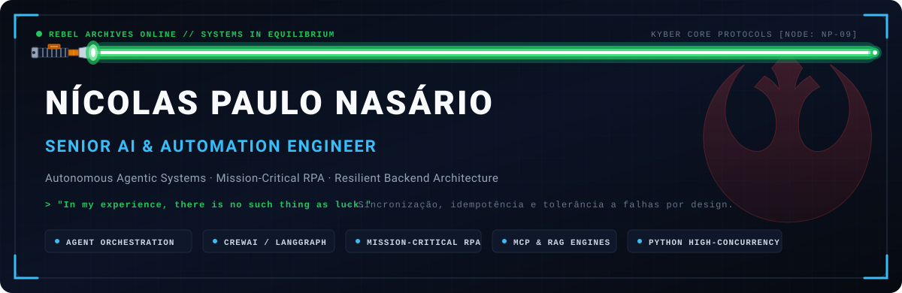
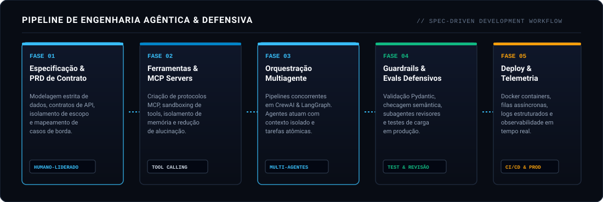
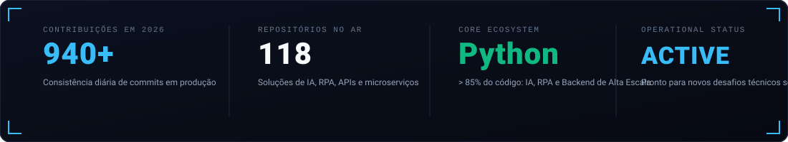

  <picture>
    <source media="(prefers-color-scheme: dark)" srcset="https://raw.githubusercontent.com/nicolaspn09/nicolaspn09/main/assets/banner-dark.svg">
    <source media="(prefers-color-scheme: light)" srcset="https://raw.githubusercontent.com/nicolaspn09/nicolaspn09/main/assets/banner-light.svg">
    
  </picture>

  

Engenheiro de Software e Automação sênior focado na intersecção entre **Inteligência Artificial Agêntica**, **RPA de Missão Crítica** e **Arquiteturas Backend Resilientes em Python**.

Atuo projetando e operando sistemas que unem a precisão determinística do código corporativo (APIs, microsserviços, automação fiscal e mensageria) à capacidade cognitiva de agentes autônomos (CrewAI, LangGraph, RAG e MCP). Não construo experimentos isolados: meu foco é colocar agentes e robôs em **operação contínua com usuários reais**, com tolerância a falhas, guardrails defensivos e observabilidade em tempo real.

<b>Read this profile in English</b>

 

Senior Software and Automation Engineer working at the intersection of **Agentic AI**, **Mission-Critical RPA**, and **Resilient Python Backend Architectures**.

I design and operate production-grade systems that combine the deterministic rigor of enterprise software (APIs, microservices, tax automation, and messaging) with the cognitive capabilities of autonomous AI agents (CrewAI, LangGraph, RAG, and MCP). I do not build isolated toy demos: my focus is deploying autonomous agents and resilient bots into **continuous production with real users**, enforcing strict fault tolerance, defensive guardrails, and real-time observability.

**Core Principles:**
- **Deterministic Core, Cognitive Edge:** Business-critical logic belongs in deterministic code; LLMs are orchestrated with strict schema validation (Pydantic) and tool contracts.
- **Fail-Safe & Idempotency:** Any automation interacting with third-party portals or APIs must handle rate limits, network partitions, and unpredictable DOM changes gracefully.
- **Observability by Design:** Structured logs, tracing, and health telemetry across every worker and agent invocation.

---

## 🛠️ O Que Eu Construo (Sistemas em Produção)

<table>
  <thead>
    <tr>
      <td colspan="2">
        <b>Fundação Arquitetural:</b> Python 3.11+, FastAPI, PostgreSQL, Redis, Celery e Docker. Orquestração com Hermes Agent, CrewAI e LangGraph. RAG Híbrido em bases regulatórias complexas, mensageria assíncrona com Evolution API (WhatsApp) e guardrails defensivos anti-alucinação.
      </td>
    </tr>
    <tr>
      <th width="32%">Sistema / Solução</th>
      <th width="68%">Escopo, Arquitetura &amp; Impacto</th>
    </tr>
  </thead>
  <tbody>
    <tr>
      <td>
        <b><a href="https://lecionaai.com.br" target="_blank">LecionaAI — SaaS de IA</a></b> <small>(<a href="https://github.com/nicolaspn09/assistente-ia-rag-educacao">Repo</a>)</small> 
        <code>FastAPI</code> <code>PostgreSQL</code> <code>RAG</code> <code>Docker</code> <code>LLMs</code>
      </td>
      <td>
        Plataforma SaaS full-stack em produção (<a href="https://lecionaai.com.br" target="_blank">lecionaai.com.br</a>) para o ecossistema educacional. Backend em FastAPI com autenticação JWT, integração com LLMs para elaboração automática de planos de aula e avaliações alinhadas à BNCC, além de RAG especializado para suporte a necessidades educacionais inclusivas.
      </td>
    </tr>
    <tr>
      <td>
        <b><a href="https://github.com/nicolaspn09/agente-reforma-tributaria">Consultor RAG Reforma Tributária</a></b> <small>(<a href="https://agente-reforma-tributaria.streamlit.app" target="_blank">Live Demo</a>)</small> 
        <code>RAG Híbrido</code> <code>LCP 214/2025</code> <code>Streamlit</code> <code>Vector DB</code>
      </td>
      <td>
        Arquitetura RAG de alta fidelidade baseada na regulamentação da LCP 214/2025 e EC 132. Combinação de busca semântica em banco vetorial com guardrails determinísticos para consulta fiscal sem alucinação de alíquotas ou regras tributárias complexas. Possui interface interativa em produção no Streamlit.
      </td>
    </tr>
    <tr>
      <td>
        <b><a href="https://github.com/nicolaspn09/analise-isencao-reforma-tributaria">Análise Fiscal &amp; Isenção de Impostos</a></b> 
        <code>Python</code> <code>OpenAI</code> <code>Oracle ERP</code> <code>Excel</code>
      </td>
      <td>
        Automação analítica para cruzamento de dados fiscais sob a nova legislação tributária. Integração direta com ERP Oracle e planilhas complexas, aplicando engenharia de prompts defensiva para classificação de itens e disparo de relatórios automatizados de auditoria.
      </td>
    </tr>
    <tr>
      <td>
        <b><a href="https://github.com/nicolaspn09/bot-whatsapp-ia-evolution-api">WhatsApp AI Gateway</a></b> 
        <code>Docker</code> <code>Evolution API</code> <code>LangChain</code> <code>Redis</code>
      </td>
      <td>
        Gateway corporativo conteinerizado em Docker para atendimento inteligente via WhatsApp. Processamento assíncrono de mensagens, recuperação de contexto de sessão em Redis e execução segura de tool-calling com guardrails anti-alucinação.
      </td>
    </tr>
    <tr>
      <td>
        <b><a href="https://github.com/nicolaspn09/agente-ia-criador-conteudo-youtube">Pipeline Agêntico Multimídia</a></b> 
        <code>CrewAI</code> <code>LangChain</code> <code>Python</code> <code>LLMs</code>
      </td>
      <td>
        Arquitetura multiagente com divisão estrita de responsabilidades: agentes autônomos para mineração de tendências, síntese de roteiros e revisão técnica de hooks e metadados, operando em esteira determinística e validada.
      </td>
    </tr>
    <tr>
      <td>
        <b><a href="https://github.com/nicolaspn09/rpa-analise-concorrencia-mercado-livre">RPA de Inteligência Comercial</a></b> 
        <code>Selenium</code> <code>undetected-chromedriver</code> <code>Pandas</code>
      </td>
      <td>
        Pipeline corporativo de web scraping e inteligência de mercado em e-commerce. Bypass defensivo de barreiras anti-bot, rotação de headers, extração em alta escala de precificação concorrente e modelagem de dados para BI.
      </td>
    </tr>
  </tbody>
</table>

---

## 🤖 Metodologia de Engenharia Agêntica

Trato agentes autônomos como componentes de software distribuído: **eu defino a arquitetura, modelo os contratos e especifico as restrições; os agentes executam e validam em paralelo.**

  <picture>
    <source media="(prefers-color-scheme: dark)" srcset="https://raw.githubusercontent.com/nicolaspn09/nicolaspn09/main/assets/workflow-dark.svg">
    <source media="(prefers-color-scheme: light)" srcset="https://raw.githubusercontent.com/nicolaspn09/nicolaspn09/main/assets/workflow-light.svg">
    
  </picture>

* **Agentes Autônomos com Memória Persistente:** Operação avançada com **Hermes Agent (Nous Research)** e **LangGraph**, aplicando retenção de memória de longo prazo, isolamento de estado e tool-calling determinístico.
* **Desenvolvimento Guiado por Especificação (Spec-Driven):** Modelagem rigorosa de dados (Pydantic), contratos de API e definição explícita de casos de borda antes de qualquer execução de LLM.
* **Protocolos MCP (Model Context Protocol):** Construção e conexão de servidores MCP customizados para isolamento de contexto, controle de memória persistente e acesso seguro a bases e APIs externas.
* **Orquestração Multiagente Concorrente:** Pipelines com **CrewAI** e **LangGraph**, estruturando agentes especialistas com responsabilidades atômicas para evitar saturação de janela de contexto.
* **Defensive Guardrails & Evals:** Verificação sintática e semântica de saídas de LLM, com subagentes de revisão atuando em paralelo para eliminar alucinações antes da persistência.

---

## ⚡ Stack Tecnológica

| Domínio | Ferramentas & Tecnologias |
| :--- | :--- |
| **Inteligência Artificial & Agentes** | <code>Hermes&nbsp;Agent</code> <code>CrewAI</code> <code>LangChain</code> <code>LangGraph</code> <code>Anthropic&nbsp;Claude</code> <code>OpenAI&nbsp;API</code> <code>MCP&nbsp;(Model&nbsp;Context&nbsp;Protocol)</code> <code>RAG&nbsp;Híbrido</code> <code>Ollama</code> <code>Vector&nbsp;DBs</code> |
| **Backend & Engenharia de Dados** | <code>Python&nbsp;3.11+</code> <code>FastAPI</code> <code>Django</code> <code>PostgreSQL</code> <code>Redis</code> <code>Celery</code> <code>Pandas</code> <code>Pydantic</code> <code>SQLAlchemy</code> |
| **Automação & RPA de Missão Crítica** | <code>Selenium</code> <code>Playwright</code> <code>undetected-chromedriver</code> <code>PyAutoGUI</code> <code>PyGetWindow</code> <code>BeautifulSoup</code> <code>Certificados&nbsp;A1/A3</code> <code>eCAC/Fiscal</code> |
| **Infraestrutura, DevOps & Mensageria** | <code>Docker</code> <code>Docker&nbsp;Compose</code> <code>Linux&nbsp;(Ubuntu&nbsp;VPS)</code> <code>Git&nbsp;/&nbsp;GitHub&nbsp;Actions</code> <code>Nginx</code> <code>Evolution&nbsp;API&nbsp;(WhatsApp)</code> |
| **Harness, Tooling & Produtividade** | <code>Google&nbsp;Antigravity</code> <code>Cursor</code> <code>GitHub&nbsp;Copilot</code> <code>Claude&nbsp;Code</code> <code>Postman</code> |

---

## 📊 Telemetria & Métricas do Sistema

  <picture>
    <source media="(prefers-color-scheme: dark)" srcset="https://raw.githubusercontent.com/nicolaspn09/nicolaspn09/main/assets/stats-dark.svg">
    <source media="(prefers-color-scheme: light)" srcset="https://raw.githubusercontent.com/nicolaspn09/nicolaspn09/main/assets/stats-light.svg">
    
  </picture>

 

  <picture>
    <source media="(prefers-color-scheme: dark)" srcset="https://raw.githubusercontent.com/nicolaspn09/nicolaspn09/main/assets/footer-dark.svg">
    <source media="(prefers-color-scheme: light)" srcset="https://raw.githubusercontent.com/nicolaspn09/nicolaspn09/main/assets/footer-light.svg">
    
  </picture>

